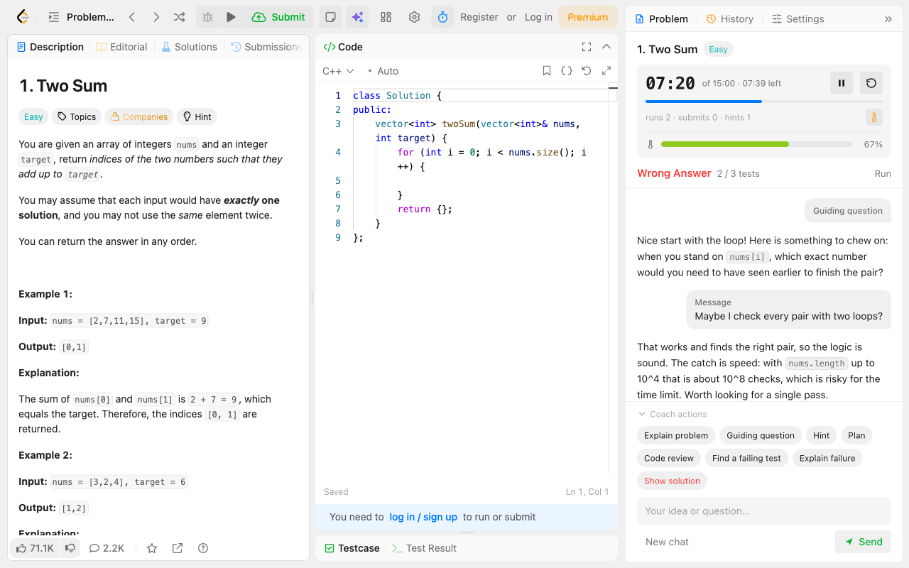
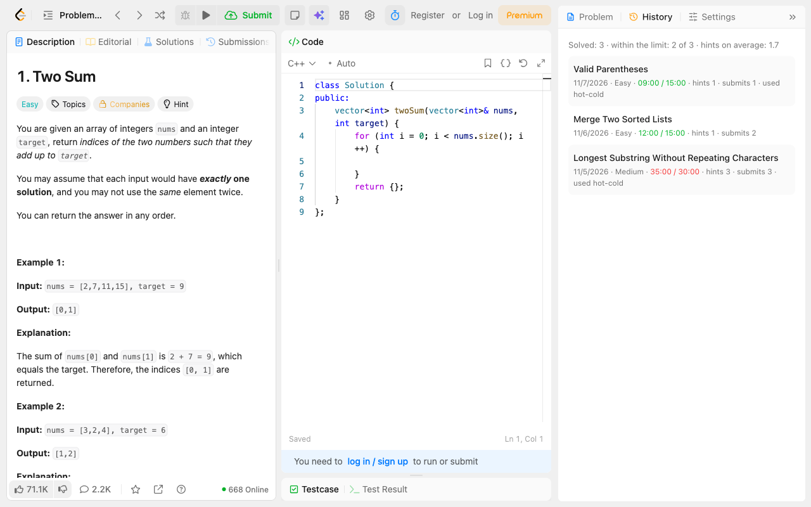
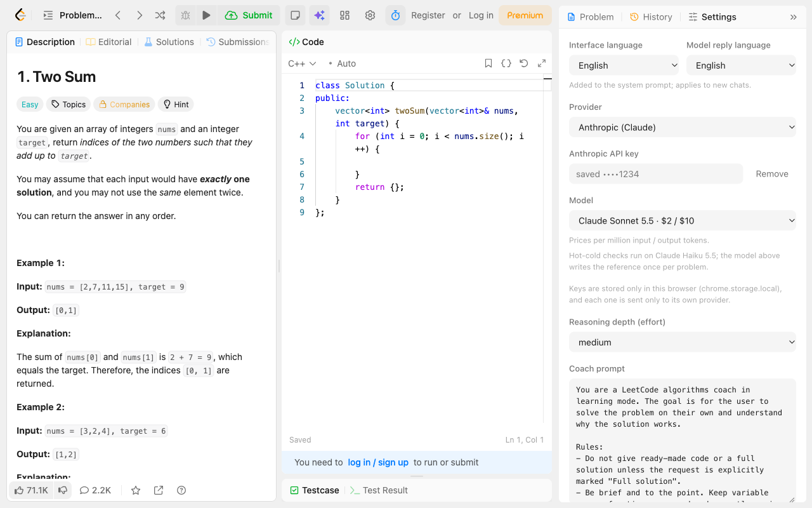
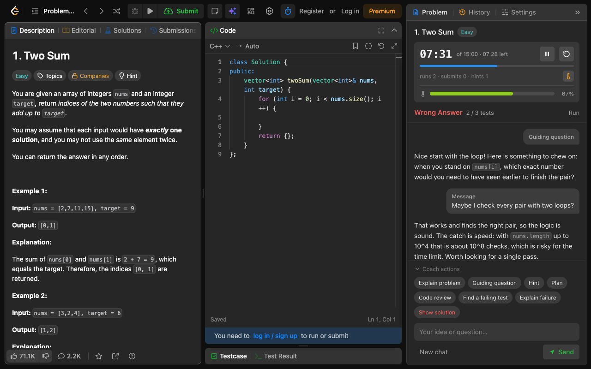

# AI Coach for LeetCode

**A learning mode for LeetCode.** 🧠
Solve the problem yourself, with a coach that nudges instead of spoiling.

## ✨ What it is

AI Coach for LeetCode puts a panel next to every problem: a timer, a ladder of hints, code review, a failing-test finder and a live **hot-cold** progress bar. It is built to make you think, not to hand you the answer.

It runs on the AI model you choose: **Claude**, **OpenAI** or any model on **OpenRouter**, with your own API key.

> AI Coach for LeetCode is an independent project, not affiliated with LeetCode.

## 🪜 The buttons

| | Button | What you get |
|---|---|---|
| 📖 | **Explain problem** | The task in plain words, with the first example walked through. A translation first if the statement is in another language. Zero spoilers. |
| 🤔 | **Guiding question** | One question that points you at the key observation. The gentlest nudge. |
| 💡 | **Hint** | The key idea and why it fits. No code, no steps. |
| 🗺️ | **Plan** | A step-by-step plan in words or pseudocode, with the target complexity. Still no code. |
| 🔍 | **Code review** | Bugs, missed edge cases and complexity of the code you have right now. It points, it does not rewrite. |
| 🧪 | **Find a failing test** | One valid input your code fails, ready to paste into Testcase, with the expected output. |
| 🩺 | **Explain failure** | Shows up after a failed Run or Submit: why that test fails, without the fix. |
| 🏁 | **Solution debrief** | Shows up after Accepted: complexity, whether it is optimal, edge cases, similar problems to practise. |
| 🔓 | **Show solution** | The full solution with code. Needs a second click, so no accidental peeking. |

Hover over any button to see what it does. Asking for a hint again gives the same idea from a new angle; it never skips a step of the ladder on its own. On a small screen, fold the buttons away with **Coach actions** to give the chat more room; the panel also tightens its layout on short windows.

## 🌡️ Hot-cold

Click the thermometer under the timer and a bar shows, while you code, how close you are to a working solution: red when you are heading the wrong way, green when you are almost there. Hover over it for a short, spoiler-free note. It refreshes a few seconds after you stop typing.

## 💬 Talk it through

Type your idea into the chat. The coach tells you honestly whether it works, and if it does not, shows the shortest input it breaks on, without telling you what would work instead. Want a hint or the solution? Just ask for it. Code in answers comes with a **Copy** button.

The coach is friendly, short and to the point, and it sees your latest code, the timer and your last Run or Submit result with every message.

## ⏱️ Timer and 📈 history

- The timer starts when **you start writing code**, not when you open the problem, and runs only while the problem is on screen.
- Limits per difficulty (15 / 30 / 45 minutes by default, all adjustable). Yellow when time is short, red with the overtime after the limit.
- Pause, resume, or reset the timer together with the chat.
- Every problem you get Accepted lands in **History**: time against the limit, hints taken, submissions, whether you peeked at the solution, and what the AI requests for it cost. The total spent is at the top.

## 🎛️ Make it yours

- 🤖 **Any model:** Claude Opus, Sonnet or the budget-friendly Haiku; any OpenAI model; or hundreds of OpenRouter models listed from the cheapest, with prices shown.
- 🧩 **Reasoning depth:** low for quick and cheap, high for thorough.
- 🌍 **Six languages:** English, Español, Italiano, Français, Deutsch, Русский, for the interface and, separately, for the coach's answers.
- ✍️ **Your own coach prompt**, in any language, with a one-click way back to the default.
- 🌗 **Light and dark** themes that follow LeetCode.

## 🔒 Private by design

- 🗝️ Your API keys stay in the browser, in storage that web pages, including LeetCode itself, cannot read.
- 🙈 A saved key is never shown again, only its last four characters. Remove it any time.
- 📮 Your problem, code and messages go only to the AI provider you picked, and only when you ask.
- 🚫 No servers of ours, no accounts, no analytics, no tracking.

Read the full [privacy policy](https://github.com/ByMarsel/coach-for-leetcode/blob/main/PRIVACY.md).

## 🏆 Fair play

The coach switches itself off on LeetCode contest pages: contest rules forbid AI help. It is a tool for learning and practice, so please keep it out of contests, interviews and assessments. See the [terms of use](https://github.com/ByMarsel/coach-for-leetcode/blob/main/TERMS.md).

## 🚀 Get it

Coming soon to the **Chrome Web Store**. Install it, open any problem on leetcode.com, paste your API key in **Settings**, and start solving.

## 🙋 Help

Questions, ideas or bugs: [open an issue](https://github.com/ByMarsel/coach-for-leetcode/issues) or write to [help@marsel.engineer](mailto:help@marsel.engineer).

---

LeetCode is a trademark of its owner. Claude is a trademark of Anthropic. OpenAI and OpenRouter are trademarks of their owners. · [Terms of use](https://github.com/ByMarsel/coach-for-leetcode/blob/main/TERMS.md) · [Privacy policy](https://github.com/ByMarsel/coach-for-leetcode/blob/main/PRIVACY.md)
